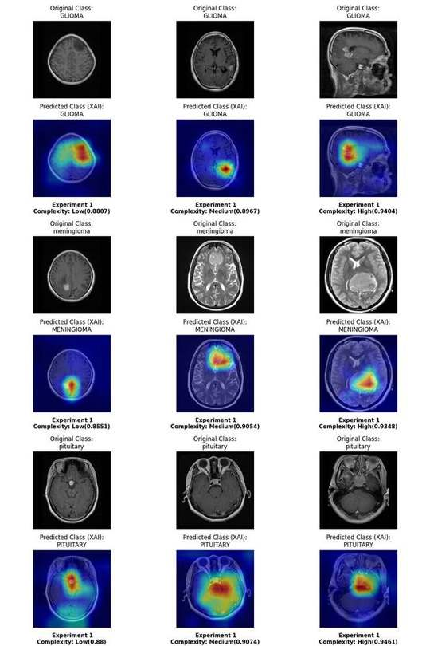

# Brain Tumor Classification on MRI with YOLOv8 + Explainable AI

Classification of brain MRI images into **glioma, meningioma, pituitary tumor or no tumor** with YOLOv8 classification models, explained with **Grad-CAM**, and evaluated with an **image-complexity analysis** across three datasets.

The repository contains a Streamlit demo app (prediction + Grad-CAM heatmap), a Gradio demo, the Grad-CAM script and the image-complexity metric used in the study.

> Research project, not a medical device.



*Correct predictions for glioma, meningioma and pituitary tumors at low, medium and high image complexity. The heatmaps show the regions that drove each prediction. A medical doctor reviewed these outputs and confirmed that the highlighted regions generally match the tumor locations.*

---

## Highlights

- **16 training configurations** comparing YOLOv8n and YOLOv8m, image sizes (128 to 640), training-set sizes (400 to 5,280 images) and epochs (25 / 50)
- **F1-score of 0.99** on the test set for the best configurations (YOLOv8n and YOLOv8m at 224 px trained on the full dataset)
- **Cross-dataset evaluation** on two independent datasets to measure generalisation, not only in-distribution accuracy
- **Image-complexity score** (persistent entropy from topological data analysis) to group test images into low / medium / high difficulty
- **Grad-CAM** explanations for correct and incorrect predictions

## Results

F1-score on the test set of each dataset (selected experiments, full tables in the report):

| Exp | Model | Train images | Img size | Epochs | Test set 1 | Test set 2 (independent) | Test set 3 (independent) |
|---|---|---|---|---|---|---|---|
| 1 | YOLOv8n | 5,280 | 224 | 50 | **0.990** | **0.821** | **0.995** |
| 16 | YOLOv8m | 5,280 | 224 | 50 | **0.993** | **0.821** | **0.995** |
| 8 | YOLOv8m | 1,320 | 224 | 25 | 0.938 | 0.808 | 0.938 |
| 2 | YOLOv8n | 2,640 | 224 | 50 | 0.970 | 0.752 | 0.976 |
| 10 | YOLOv8n | 1,320 | 320 | 50 | 0.827 | 0.489 | 0.837 |
| 13 | YOLOv8n | 400 | 128 | 25 | 0.747 | 0.506 | 0.760 |

**Main findings**

- More training data has the largest effect: the full dataset gives the best and most stable results.
- YOLOv8m is slightly better than YOLOv8n on small training sets, at about 5 times the training time per epoch.
- Training F1 is above 0.97 in almost every run, while test F1 on the second independent dataset drops to 0.49 to 0.82. This generalisation gap is the main limitation and the motivation for future work on domain adaptation.
- Test images are mostly of medium or high complexity, so the complexity score helps explain where the model fails.

## Repository structure

```
├── MRI_app.py              # Streamlit app: upload an MRI, get the prediction + Grad-CAM heatmap
├── app_gradio.py           # Gradio app: class probabilities
├── best.pt                 # Trained YOLOv8n-cls weights
├── src/
│   ├── yolo_cam.py         # Loads the YOLOv8 model in a Grad-CAM-compatible form
│   ├── gradcam.py          # Grad-CAM for a single image (command line)
│   └── image_complexity.py # Persistent-entropy image complexity score
├── assets/                 # Figures for this README
├── requirements.txt
├── requirements-complexity.txt  # Extra packages for the complexity metric
└── runtime.txt
```

## Run the demo

```bash
pip install -r requirements.txt
streamlit run MRI_app.py
```

Grad-CAM on one image from the command line:

```bash
python -m src.gradcam --model best.pt --image path/to/mri.jpg --out gradcam.png
```

Image complexity score (needs `pip install -r requirements-complexity.txt`):

```bash
python src/image_complexity.py --image path/to/mri.jpg
```

## Dataset

A public brain MRI dataset combining the **Figshare**, **SARTAJ** and **Br35H** collections, with four classes: glioma, meningioma, pituitary tumor and no tumor. Mislabelled glioma images from SARTAJ were replaced with Figshare images. Two further independent datasets were used only for evaluation. The images are not included in this repository.

## Training

Models were trained with Ultralytics YOLOv8 classification, for example:

```bash
yolo classify train model=yolov8n-cls.pt data=path/to/dataset epochs=50 imgsz=224
```

## Tech stack

Python · PyTorch · Ultralytics YOLOv8 · pytorch-grad-cam · giotto-tda · Streamlit · Gradio · OpenCV

## Author

**Tawfiq Tabouche**, PhD student at Tambov State Technical University · [LinkedIn](https://www.linkedin.com/in/toufik-tabouche)
